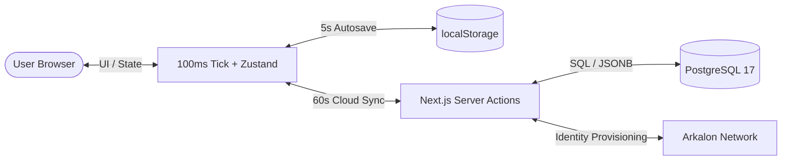

# Arkalon Laboratories

A browser-based idle game I independently designed, directed and shipped, with all code generated by LLMs. Built around a sci-fi research facility, it features three nested prestige layers, 24 restricted-run challenges, and an exact-number engine capable of scaling to 10^1000 without losing precision.

**Play:** [labs.rpsleague.fi](https://labs.rpsleague.fi/?utm_source=github) (free, no ads, no email or password)

  

## At a glance

| | |
| --- | --- |
| Role | Sole creator: architecture, design, AI direction, playtesting, deployment and operations |
| Stack | Next.js 16, React 19, TypeScript, Tailwind CSS v4, Zustand 5, PostgreSQL 17 |
| Engineering | BigInt mathematics to 10^1000, stepped offline simulation, lossless snapshots, live build detection, multi-tab sync |
| Performance | 100 ms simulation tick, cached production calculations, DOM-driven HUD updates |
| Quality | 85 Vitest tests across 9 suites, automated CI, health-checked Docker deployments |
| Infrastructure | Hetzner VPS, Docker, Caddy, PostgreSQL, GitHub Actions, Backblaze B2 |
| AI | Entire application code, tests, text and graphics generated by LLMs |
| Status | Version 1.0 live, feature-complete; balancing and polish ongoing |

## The Arkalon ecosystem

Laboratories is one of four independently deployed applications in the Arkalon ecosystem, built around a shared identity platform and production infrastructure.

| Application | Description |
| --- | --- |
| [Arkalon Network](https://network.rpsleague.fi) | Central identity hub, SSO provider, API platform and ecosystem portal |
| [RPS League](https://rpsleague.fi) | Real-time prediction arena with 3M+ matches processed |
| [Arkalon Daily](https://daily.rpsleague.fi) | Five daily cognitive puzzles with deterministic challenges and leaderboards |
| [Arkalon Laboratories](https://labs.rpsleague.fi) | Sci-fi idle research simulator with nested progression and an advanced BigInt engine |

The architecture follows a hub-and-satellite model:

- Shared identity: Network provides permanent UUIDs, procedural nicknames, account recovery and cross-application authentication through root-domain cookies.
- Isolated applications: Each application runs in its own Docker container with an independent PostgreSQL database.
- Shared infrastructure: One Hetzner VPS, Caddy reverse proxy, automatic HTTPS and private database networking.
- Independent deployment: Each application has its own GitHub Actions CI/CD workflow.
- Centralized backups: Automated daily PostgreSQL backups synchronized to Backblaze B2.

## The game

You are the Director of a research facility. Starting with 35 Research Points (RP), you build production through equipment, research, upgrades and automation.

Production runs automatically without a clicker mechanic. New systems unlock progressively through 11 facility milestones, keeping the initial experience approachable. Offline progress is simulated for up to 24 hours.

| System | Features |
| --- | --- |
| Equipment | 20 tiers, four classes, bulk purchasing, Century Mutations, generator modules and 10 synergies |
| Research | 40 standard nodes, 4 infinite nodes, four branches, parallel research and overclocking |
| Prestige | Three nested tiers, separate currencies, 32 shop upgrades and 12 automation systems |
| Relics | 20 relics, five rarities, class resonance, loadout presets and deterministic pity protection |
| Excavation | 8-probe fleet, 5 paced sectors (5m–24h), modular subsystems, batch deployment, probe recall, and 6 veteran ranks |
| Challenges | 24 challenges: 12 standard, 8 advanced and 4 extreme, plus a custom mutator sandbox |
| World systems | Spatial anomalies, Particle Collider, 4 Synthesizers, 90-day Operations epochs, megaprojects and Dyson Swarm |
| Progression | 33 achievements, 7 eras, 60 visual number tiers and Endless Mode toward 10^1000 |

Additional features include five interface themes, responsive mobile navigation, keyboard shortcuts, an installable PWA, Web Audio sound effects and optional browser-based text-to-speech.

## Engineering highlights

The following describes the implemented systems and their technical characteristics. All application code was generated by LLMs under my direction.

### 1. Exact numerical computation to 10^1000

JavaScript's native Number type overflows around 1.79 × 10^308, making it unsuitable for the game's exponential economy.

The simulation uses native BigInt for balances, costs and production values. Exponent calculations use logarithmic representations, including hex-sliced base-10 logarithms. Bulk purchasing uses segmented geometric series to account for cost breakpoints at units 1 and 100, with binary search determining the maximum affordable quantity.

Validation includes affordability boundaries up to 10^200 and beyond, large-number formatting, and enforcement of the 10^1000 hard cap.

### 2. Boundary-aware offline simulation

Offline progression cannot simply multiply elapsed time by production when research finishes, anomalies expire or megaprojects complete during the offline window.

The simulator advances through relevant state boundaries, using up to 48 segments and recalculating production when necessary. It also handles queued research, probe expeditions, repair cycles and recursive challenge EC3 collapse.

Tests cover 8, 12 and 24-hour limits, efficiency stacking, research completion, anomaly expiry, megaproject absorption and probe relaunch cycles.

### 3. Lossless challenge snapshots

Challenges operate as isolated side runs rather than permanently replacing the player's current progression.

Entering a challenge serializes the active state, including resources, equipment, research, anomaly timers and megaproject progress. Completing or abandoning the challenge restores the original state.

Tests verify restoration across victories, abandonment, EC2 type switching and custom sandbox runs.

### 4. Performance-conscious simulation

Production is recalculated only when relevant state changes occur, such as purchases, research completion, relic swaps or prestige resets.

The 100 ms simulation tick reads a cached production value rather than recalculating the entire economy. The resource counter and countdown timers use direct DOM updates instead of triggering React renders every tick. Unlock and achievement checks are dirty-flag gated and staggered.

This keeps the recurring simulation workload controlled as progression becomes more complex.

### 5. Save integrity and multi-tab protection

The persistence system combines:
- Local autosaving every 5 seconds.
- Rate-limited cloud synchronization every 60 seconds.
- Timestamp arbitration when loading saves.
- Base64 and TXT export/import.
- BroadcastChannel-based tab coordination with a 3-second heartbeat and 8-second timeout.
- Automatic ownership handover if the primary tab becomes unresponsive.
- Live build detection via SHA polling with a 10-second automated save-and-reload modal to eliminate stale-client play and prevent Server Action ID desynchronization across deployments.

The server validates incoming saves, checking structure, negative balances, future timestamps and progression consistency. It also enforces a 30-second per-player rate limit.

Tests cover serialization, corrupt save rejection, v1-to-v2 migration, sanitization and server-side validation.

## Architecture

| Layer | Implementation |
| --- | --- |
| Framework | Next.js 16 App Router, React 19, TypeScript |
| Styling | Tailwind CSS v4, CSS variables |
| State | Zustand 5, separate simulation, UI and music stores |
| Simulation | Client-side 100 ms tick engine |
| Persistence | localStorage, Next.js Server Actions, PostgreSQL 17 |
| Identity | Arkalon Network shared identity hub |
| Audio | Web Audio API, HTML5 audio, Web Speech API |
| Testing | Vitest, jsdom |
| Deployment | Docker standalone build, Caddy, GitHub Actions |

### Key architectural decisions

- Server Actions instead of a separate API service: Labs does not require a persistent real-time backend. RPS League uses a dedicated Express service for its long-lived event streams.
- Cached production calculations: Event-driven recalculation keeps the recurring simulation tick lightweight.
- Challenge snapshot isolation: One serialized snapshot model handles challenge entry, completion and abandonment.
- Delegated identity: Nickname generation and account recovery are handled by Arkalon Network. Laboratories does not store emails, passwords or recovery codes.

## Testing, CI/CD and operations

85 Vitest tests across 9 suites:

| Suite | Coverage |
| --- | --- |
| productionEngine | Production calculations, milestones, exponent stacking and caps |
| generatorCosts | Cost growth, bulk pricing and affordability |
| prestigeCalc | Prestige requirements, currencies, softcaps and resets |
| researchAndRelics | Research prerequisites, relic upgrades and resonance |
| formatAndUtils | BigInt logarithms, formatting, eras and utilities |
| offlineCalc | Segmented offline simulation and edge cases |
| saveGame | Serialization, migration, import and sanitization |
| serverActions | Save validation, rate limiting, identity and health checks |
| storeAndChallenges | State management, challenge snapshots and restoration |

### Automated deployment

- CI (`ci.yml`): TypeScript typechecking, test execution and production builds on every push and pull request.
- Deployment (`deploy.yml`): GitHub Actions synchronizes the source to a Hetzner VPS, builds a Docker image, recreates the container and verifies `/api/health`.
- Health monitoring: The health endpoint performs a live PostgreSQL `SELECT 1` and returns HTTP 200 or 503.
- Graceful degradation: If PostgreSQL becomes unavailable, loading and saving fall back to localStorage without interrupting gameplay.
- Backups: Daily `pg_dump` backups at 03:00 UTC are synchronized to Backblaze B2.

## Development Process and AI Usage

Arkalon Laboratories was designed by me and implemented entirely with LLM-generated code. It is part of the wider Arkalon ecosystem, developed through continuous cycles of architecture, implementation, testing and refinement.

### Development Workflow

1. Architecture and Design: I independently define the system architecture, technical requirements, application structure and gameplay mechanics.
2. AI-Assisted Implementation: I use LLMs such as ChatGPT, Gemini and Claude to generate application code and components based on my specifications.
3. Auditing and Debugging: I direct code reviews, investigate errors, evaluate proposed fixes and iterate on the implementation.
4. Playtesting and Refinement: I test the actual application, evaluate functionality and visual design, identify issues and direct further changes.
5. Verification and Deployment: I validate the resulting behavior, run automated tests, deploy to production and maintain the live service.

### AI Usage Disclosure

- Code: All application code is LLM-generated, including TypeScript, React components, SVG graphics, styling and automated tests.
- Text: Game dialogue and Arkalon Overseer content are LLM-generated.
- Graphics: Equipment icons and the application logo are LLM-generated.
- Audio: Sound effects and music use free Pixabay assets. The Overseer voice uses the browser's native Web Speech API.

My responsibilities include the architecture, product design, technical specifications, implementation direction, code evaluation, playtesting, verification, deployment and ongoing production operation.

I take responsibility for the resulting software and validate its behavior before release.

## Documentation

| Document | Contents |
| --- | --- |
| [RESEARCH_AND_PRESTIGE.md](./RESEARCH_AND_PRESTIGE.md) | 44 research nodes, prestige tiers, 32 upgrades and automation |
| [RELICS.md](./RELICS.md) | Relic catalog, discovery, rarity and class resonance |
| [CHALLENGES.md](./CHALLENGES.md) | 24 challenges, requirements and custom mutator sandbox |
| [TESTS.md](./TESTS.md) | Test suite details and coverage |
| [CHANGELOG.md](./CHANGELOG.md) | Release history |

## Status and roadmap

Version 1.0 is live and feature-complete across the core gameplay loops, prestige systems, challenges, offline simulation and cloud persistence.

Planned improvements:
- In-app patch notes archive and manual What's New trigger.
- Shared Arkalon Network milestones and profile badges.
- Shareable run-summary cards for Omega Convergence and Extreme Challenge records.

## Compatibility and privacy

- Supported platforms: Modern desktop and mobile browsers, including Chrome, Firefox, Safari and Edge. Requires native BigInt and BroadcastChannel support.
- Accounts: Permanent UUIDs and procedural nicknames managed through Arkalon Network.
- Privacy: No email addresses, passwords or personal information are collected. Recovery credentials remain on the identity hub.
- Gameplay: All Research Points, currencies, relics and achievements are virtual and have no monetary value.

## License

Copyright (c) 2026 Alex Degerman. All Rights Reserved.

The source is publicly accessible for review. Arkalon Laboratories and all associated source code, assets, systems and files are proprietary. Unauthorized copying, modification, distribution, public hosting, sublicensing or use, in whole or in part, is prohibited without prior written permission from the copyright holder.

Part of the [Arkalon ecosystem](https://network.rpsleague.fi), alongside Arkalon Network, RPS League and Arkalon Daily.