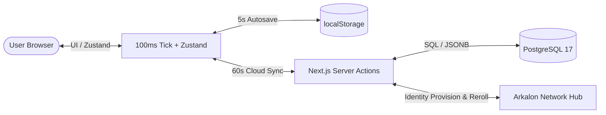

# 🔬 Arkalon Laboratories

A sci-fi idle incremental facility simulator where players engineer multi-tier research infrastructure, stabilize spatial anomalies, execute nested prestige loops, and scale Research Points (RP) into astronomical number tiers beyond 10¹⁶². Built as a self-contained Next.js application powered by a cached-PPS `BigInt` simulation engine and persistent cloud synchronization.

**Play Here:** [https://labs.rpsleague.fi/](https://labs.rpsleague.fi/?utm_source=github/)

## 🎮 Preview

> **Media Showcase Pending:** Gameplay trailer and system highlight GIFs will be linked here once final launch capture is published.

> **🌐 Part of the Arkalon Network:** Arkalon Laboratories is an application in the wider Arkalon ecosystem, a multi-app platform sharing a common identity layer, visual language, and cross-app features. The network beacon connects players to Arkalon AI, feedback systems, release updates, and other ecosystem applications.

> **🚀 Development Status:** Version 1.0 is feature-complete across all core progression loops, prestige tiers, challenges, offline simulation, and cloud persistence. Development focus continues alongside the wider Arkalon ecosystem with ongoing balance tuning, polish, and quality-of-life updates.

---

## 📑 Table of Contents

### Core Systems

- [Identity & Zero-Friction Account System](#-identity--zero-friction-account-system)
- [Core Production & Equipment](#-core-production--equipment)
- [Overview](#-overview)
- [Research Matrix](#-research-matrix)
- [Nested Prestige & Automation](#-nested-prestige--automation)
- [Relics & Artifacts](#-relics--artifacts)

### World & Endgame Systems

- [Excavation & Sub-Space Probes](#-excavation--sub-space-probes)
- [Spatial Anomalies & Particle Collider](#-spatial-anomalies--particle-collider)
- [Anomalous Operations](#-anomalous-operations)
- [Megaprojects & Endgame](#-megaprojects--endgame)
- [Facility Challenges & Sandbox](#-facility-challenges--sandbox)

### Progression Systems

- [Facility Achievements](#-facility-achievements)
- [Infinite Number Scaling & Visual Tier System](#-infinite-number-scaling--visual-tier-system)
- [Global Number Formatting Engine](#-global-number-formatting-engine)

### Diagnostics & Discovery

- [Operational Diagnostics & Progression Directory](#-operational-diagnostics--progression-directory)

### Engineering

- [Architecture](#-architecture)
- [Design Decisions](#-design-decisions)
- [Technical Challenges & Solutions](#-technical-challenges--solutions)
- [Reliability & Observability](#-reliability--observability)

### Platform

- [Arkalon Overseer & Voice](#-arkalon-overseer--voice)
- [Mobile, PWA & Customization](#-mobile-pwa--customization)

### Development

- [Tests](#-tests)
- [CI/CD & Automation](#-cicd--automation)
- [Future Improvements](#-future-improvements)
- [Changelog](#-changelog)

### Meta

- [Device Compatibility](#-device-compatibility)
- [Disclaimer](#-disclaimer)
- [Privacy, Telemetry & Security](#-privacy-telemetry--security)
- [License](#-license)

---

## ⚡ Identity & Zero-Friction Account System

Operating as an Arkalon Network satellite app, Arkalon Laboratories delegates all core identity provisioning and recovery to the central Arkalon Network Hub. Players begin building immediately with no email, password, or registration walls.

- **Interactive Onboarding:** A Welcome Modal for first-time Directors introduces the facility and provides instant procedural nickname rerolling via the Arkalon Network before initializing the lab.
- **Dual-Layer Persistence:** Automatic `localStorage` checkpoints run every 5 seconds (and on tab hide/unload), paired with rate-limited PostgreSQL cloud synchronization every 60 seconds and manual `Sync Now` / Base64 / `.txt` export-import backup tools.
- **Timestamp-Arbitrated Recovery:** On boot, the client compares local and cloud timestamps, loads the newest state, and simulates missed wall-clock progression automatically.
- **Network Identity Recovery:** Master recovery codes (`WORD-WORD-0000`) and cross-device identity restoration are delegated exclusively to `network.rpsleague.fi` via deep-linked return flows.
- **Release Version Tracking:** Client-side version tracking surfaces a "New Update" changelog overlay when returning players load a newly deployed release.

---

## 🔬 Core Production & Equipment

- Players start with **35 RP**—calibrated to purchase their first two Research Desks—and scale through 20 escalating equipment tiers up to a `10^1000` endless ceiling.
- Every generator tier belongs to one of four classes (`Computation`, `Energy`, `Reality`, `Arkalon`), feeding branch research, relic synergies, and anomaly buffs.
- Equipment cards render class-themed glow frames, real-time yield share bars (`%` of total RP/s), time-to-afford ETAs (net of active Megaproject allocation), and 6 progressive SVG visual evolution stages (`1`, `10`, `25`, `50`, `100`, `250` owned).

### Generators & Century Mutations

- **20 Equipment Tiers:** Scales from **Research Desk** (`15 RP`, `1 RP/s`) and **Server Cluster** (`120 RP`, `4 RP/s`) through **Singularity Reactor**, **Infinite Simulation**, **Galactic Engine**, and **Absolute Void Compressor** (`6.5e25 RP`, `1.9e21 RP/s`).
- **Bulk Procurement:** Supports `x1`, `x10`, `x100`, `NEXT` (exact units to the next milestone), `MAX`, and `MAX ALL (M)` sweeps.
- **Quantity Milestones:** Standard generators trigger milestones every `25` units (`10` units up to `50` for Research Desks). The first `8` milestones double output (`2x` up to `256x`), steps `9–100` taper at `1.08x`, and steps beyond `100` scale linearly (`+5%` per step) to preserve late-game balance. Thresholds can be compressed down to `10` via Prestige upgrades, Relics, and Challenges.
- **Century Mutations:** Crossing major ownership thresholds unlocks permanent chassis breakthroughs:
  - **M100 (`Overclock Synthesis`):** `2x` base output and `-0.005` cost growth factor.
  - **M250 (`Sub-harmonic Resonance`):** `3x` output and `+10%` cross-generator synergy contribution.
  - **M500 (`Dimensional Singularity`):** `5x` output and `+5%` global class output per M500 chassis in the same class.
  - **M1000 (`Trans-Finite Ascendance`):** `10x` output and `+0.01` global production exponent.

### Synthesizers & Secondary Resources

- **4 Dedicated Synthesizers:** Non-RP infrastructure unlocked progressively alongside Relics, Excavation, Anomalous Operations, and Megaprojects:
  - **Dust Condenser:** Generates passive **Artifact Dust** (`+0.5/min`) for Relic upgrades and Particle Collider synthesis.
  - **Sub-Space Dredger:** Generates `+3 Dust/min` and accelerates Probe scan speeds by `+5%` per unit.
  - **Cosmic Telemetry Array:** Generates `+2 Operation Points/min` (tripled to `3x` while any Operation Anomaly is active).
  - **Entropic Crucible:** Generates `+25 Dust/min`, `+10 Operation Points/min`, and boosts all Synthesizers by `+25%` per unit.
- **Era & Swarm Dust Scaling:** All Synthesizer Dust output scales by `+50%` per current run Era and `+25%` per Dyson Swarm level.

### Generator Modules & Cross-Generator Synergies

- Unlocks at `10` Server Clusters, exposing three installable upgrade tracks per owned generator: **Output Boost** (`1.25^level` compounding output), **Cost Discount** (`-0.015` price scaling per level, floored at `1.01`), and **Cross-Boost** (powers cross-generator boosts on Tiers `1–10` and completes the set bonus on Tiers `11–20`).
- **Core Cap & 2x Maxed Set Bonus:** Base core cap is **Level 5** (expandable up to **Level 8** via Advanced Challenge `AC5`). Maxing all three tracks at the core cap permanently unlocks a **2x output** and **`+25%` cross-boost** bonus.
- **Prestige & Era Overdrive Scaling:** **Output Boost** and Tiers `1–10` **Cross-Boost** expand into deep endgame—**Lv15** (Tier I / `10¹⁸` RP), **Lv30** (Tier II / `10³⁵` RP), **Lv75** (Tier III / `10⁸⁵` RP), and **Lv250** (Node `O10` / `10¹⁴⁰` RP)—using pure `BigInt` cost scaling (`10x`/`25x` → `100x` → `1000x`), while **Cost Discount** and Tiers `11–20` **Cross-Boost** stay at the core cap so RP is never wasted.
- **10 Cross-Generator Synergy Links:** Dedicated links (such as *Historic Validation*, *Grid Management*, *Superposition Link*, and *Matter Coding*) turn owned units of one generator into percentage multipliers on a paired tier, viewable in the **Synergy Links** panel.
- **UI & Bulk Upgrades:** Includes `All` / `Upgradable` filters, collapsible maxed cards, and a unified **Upgrade All** button (`Bulk Procurement`) displaying exact upgrade count, RP cost, and remaining cost to max owned generators.

---

## 📋 Overview

- **High-Precision 100ms Engine:** Tick loop reads a single precomputed `cachedPointsPerSecond` `BigInt` (`recalcPPS` runs only on state-changing events), sustaining smooth 10Hz updates without per-tick math overhead.
- **Segmented Geometric Bulk Pricing:** Exact `BigInt` geometric series calculation across `R1` (unit #1) and `M100` (unit #100) cost-scaling boundaries up to `10,000,000` units per click.
- **Staggered Progression Unlocks:** 11 facility systems unlock sequentially as milestones are reached, highlighting newly online systems in the Directory and mobile nav with `NEW` / `Action Ready` indicators.
- **Multi-Tab Guard:** `BroadcastChannel` with heartbeat takeover prevents duplicate browser tabs from overwriting saves or desynchronizing timers.
- **Stepped Offline Progression:** Up to 24 hours of simulated offline time stepped across research completions, auto-queued nodes, anomaly expirations, megaproject absorption, probe expeditions, and forced challenge collapses.
- **Adaptive BGM & Polyphonic SFX:** Context-aware music crossfading (`idle` playlist rotation vs. `anomaly` intensity) paired with Web Audio API polyphonic sound effects.

---

## 🧪 Research Matrix

Unlocks at `10` Research Desks and serves as the facility’s timed technology tree.

### Four Branches & Infinite Nodes

- **40 Standard Nodes + 4 Infinite Nodes:** Organized across four specialized branches—**Computation** (`C1–C10`), **Energy** (`E1–E10`), **Reality** (`R1–R10`), and **Arkalon** (`O1–O10`)—with Grid and vertical Dependency Tree view modes.
- **Parallel Processing:** Starts with 1 active research slot; **Node R3** unlocks a 2nd slot and CF **Deep Research Slots** unlocks a 3rd. Parallel slots must study distinct branches simultaneously.
- **Infinite Scaling Nodes:** Completing Tier 8 of any branch unlocks its repeatable infinite node (`C_INF`, `E_INF`, `R_INF` capped at 95% speed reduction, and `O_INF`), with `+1` / `+10` / `MAX` bulk purchase controls.

### Overclocking, Queue & O6 Bypass

- **Active Overclocking:** Spend liquid RP directly on an active research slot to shave `25%` of total study time immediately.
- **Study Queue & Smart Presets:** Unlocked via AR `Auto-Research Queue`, allowing `4–8` queued projects with one-click sorting presets (`Shortest`, `Cheapest`, `Rush Tier`) and manual drag-free reordering.
- **O6 Prerequisite Bypass:** Completing Node `O6` permits bypassing one missing prerequisite node per prestige run.

> 📋 **[View full Research & Prestige breakdown →](./RESEARCH_AND_PRESTIGE.md)**

---

## 🔄 Nested Prestige & Automation

Unlocks at `1.00 Billion` (`10⁹`) lifetime RP, layering three nested reset loops with persistent meta-currencies and progressive automation.

### Three Prestige Tiers

- **Tier I — Reality Recalibration:** Earns **Arkalon Resonance (AR)** (`5 * sqrt(lifetimeRP / 10^9)`, softcapped above `500,000 AR`). Counted AR grants `+10%` passive RP per unit up to a `500` base cap (expandable via `Harmonic Resonance Cap`). Keeps modules, synthesizers, AR upgrades (16 upgrades), relics, achievements, and operations.
- **Tier II — Timeline Severance:** Requires the **Chronos Array** megaproject and `10^35` lifetime RP. Earns **Chronal Fractures (CF)** (`10` upgrades including *Quantum Memory*, *Deep Research Slots*, and *Relic Preservation*). Preserves a permanent **Resonance Memory** AR floor across resets.
- **Tier III — Singular Synthesis:** Requires the **Omega Singularity Sphere** megaproject and `10^85` lifetime RP. Earns **Omni-Spars (OS)** (`6` upgrades including *Dimensional Transcendence*, *Exponential Catalyst*, and higher-tier automation). Preserves quality-of-life automation unlocks across resets.

### Automation Suite & Smart Auto-Prestige

- **12 Toggleable Systems:** Includes *Auto-Buy (Basic)*, *Auto-Buy (Optimal)* (highest marginal PPS/RP with configurable RP reserve), *Auto-Buy Synthesizers*, *Auto-Research Queue*, *Auto-Module Buyer*, *Auto-Equip Relic*, *Auto-Upgrade Relics* (with level cap and Dust reserve), *Auto-Launch Probe (Safe)*, *Auto-Dyson Swarm*, and Auto-Prestige Tiers I–III.
- **Smart Auto-Prestige Calibration:** Tier I automation supports three modes—`Fixed AR`, `Multiplier` (ratio vs. current AR), and `PPS Stall` (triggers when RP/s growth stalls `≤1%` over 15s)—alongside megaproject hold protection, Tier II wait guards, a 10s anomaly grace window, and a cancelable 3-second countdown banner.

> 📋 **[View full Research & Prestige breakdown →](./RESEARCH_AND_PRESTIGE.md)**

---

## 💎 Relics & Artifacts

Unlocks after resolving your first Anomaly or completing Node `O1` (`Synaptic Resonance`), awarding **Relic 1 (Arkalon's Left Eye)** immediately.

- **20 Unique Relics:** Spanning five rarity tiers (`Common`, `Rare`, `Epic`, `Legendary`, `Mythical`) and four classes (`Computation`, `Energy`, `Reality`, `Arkalon`), discoverable through research milestones, generator milestones, prestige resets, anomalies, and excavation.
- **Deterministic Pity Protection:** Guarantees **Relic 4** by your 25th completed research node and **Relic 9** by your 8th Unstable/Void probe expedition.
- **Class Resonance & Presets:** Starts with `3` active sockets (expandable to `6` via `SC11`) with instant swapping, `+1 / +10 / MAX` Dust upgrades up to Lv100 (`Lv20` for Relic 20), **Class Resonance** bonuses for equipping 2 (`+15%` effects) or 3 (`+35%` effects + `+10%` class output) matching relics, CF *Relic Preservation* (`+25%` equipped relic effectiveness), and `3` saved Loadout Presets (`Speedrun`, `Deep Idle`, `Surge Hunter`).

> 📋 **[View full Relic system breakdown →](./RELICS.md)**

---

## 🔭 Excavation & Sub-Space Probes

Unlocks at `25` Server Clusters and `10` Quantum Computers, starting with `5` probe slots (`1M RP` each) and expanding up to `8` probes across Tier II, Tier III, and `O10`.

- **5 Sector Tiers (Early → Endgame):**
  - **Safe Sectors (`1h`):** `100%` success rate, `15–30` base Dust.
  - **Unstable Rifts (`4h`):** `75%` success rate, `80–160` base Dust, `+5–15` Operation Points, `5%` Relic 9 drop chance (`10m` repair on fail).
  - **Void Depths (`12h`):** `50%` success rate, `450–900` base Dust, `+25–60` PTS, `-5%` active Research timers, `15%` Relic 9 drop chance (`30m` repair + salvage on fail).
  - **Singularity Rift (`24h`, Tier II / Era 4):** `40%` base success, `1,800–3,200` base Dust, `+75–150` PTS, `-10%` Research timers (`45m` repair + salvage).
  - **Omega Horizon (`48h`, Tier III / Era 6):** `35%` base success, `4,500–8,000` base Dust, `+200–400` PTS, `-25%` Research timers, `25%` Anomaly ignition (`60m` repair + salvage).
- **Speed-Overflow & Era/Swarm Scaling:** Probe Dust scales with Era (`+50%`/Era) and Dyson Swarm (`+25%`/level). Once `Sub-Space Dredgers` push scan times below the `60s` floor, excess speed converts directly into a yield multiplier.
- **Modular Subsystems & Auto-Launch:** Equip `Standard`, `Aegis Shielding` (`-50%` repair times), `Tachyon Thrusters` (`-35%` scan time), or `Deep-Core Siphon` (`+50%` Dust, `+5%` relic chance). `SC12 Tier 3` unlocks configurable sector Auto-Launch.
- **Veteran Rank Progression:** Probes rank up from **Rookie** to **Apex Drone** (`Lv5` at 15 expeditions), earning up to `+25%` mission success rate and `1.5x` yield.

---

## 🌀 Spatial Anomalies & Particle Collider

Unlocks after completing `2` standard research nodes post-onboarding, introducing periodic reality distortions every `3–6` minutes (predictable via a live countdown once Node `O3` is studied).

- **4 Standard Anomalies:** **Quantum Surge** (`4x` global RP), **Temporal Distortion** (`10x` research speed), **Containment Breach** (`2x` RP + `50%` generator cost reduction), and **Arkalon Resonance** (`3x` RP + `25%` tech cost reduction).
- **Operation & Fused Anomalies:** Once Anomalous Operations are unlocked, `20%` of spawns convert into the active Operation Cycle's anomaly. Reaching Era 5 (`10^60` RP) unlocks a `20%` chance for **Fused Anomalies** (*Singularity Surge* and *Chronal Resonance*) combining overlapping buffs.
- **Cascade & Particle Collider:** Resolving any anomaly carries a `10%` chance to trigger an immediate follow-up cascade. Players can also manually ignite an anomaly on demand via the **Particle Collider** using `25` Artifact Dust.

---

## 🪐 Anomalous Operations

Unlocks on your first Reality Recalibration, introducing rotating **90-day Cosmic Observation Epochs** that grant permanent progression perks.

- **4 Rotating Epochs:** Cycles through **Chrono-Freeze Flux**, **Solar Flare Overload**, **Gravity Sink Collapse**, and **Matrix Inversion**. Players can use the **Cosmic Retuning Device** once per prestige run to target a specific epoch anomaly.
- **Permanent Shop & Cosmic Sinks:** Spend **Operation Points** earned by Cosmic Telemetry Arrays on `4` permanent Artifacts (*Empirical Compass*, *Chronos Loom*, *Anomalous Lens*, *Arkalon Core Synapse*) and two repeatable sinks (*Singularity Attunement* for permanent global RP and *Temporal Compression* for permanent anomaly duration).
- **Cosmic Titles:** Cumulative Operation Point investments unlock permanent rank badges from **Epoch Observer** (`5,000 PTS`) to **Architect of Constants** (`100,000 PTS`).

---

## 🚀 Megaprojects & Endgame

Unlocks at `1.00 Trillion` (`10¹²`) lifetime RP and `10` Reality Engines, letting players divert `0–100%` of passive RP/s into monumental structures.

- **Phased Construction Perks:** Every Megaproject unlocks live mid-construction bonuses at `25%`, `50%`, `75%`, and `100%` completion.
- **Three Milestone Structures:**
  - **Chronos Array:** Unlocks Tier II Prestige at `10^35` RP and grants a permanent `1.5x` global multiplier.
  - **Arkalon Matrix Mirror:** Auto-completes Tier 1–2 research nodes automatically on every prestige reset.
  - **Omega Singularity Sphere:** Unlocks Tier III Prestige at `10^85` RP and adds `+0.25` (+`0.05` Phase 2) to the master production exponent.
- **Repeatable Arkalon Dyson Swarm:** Unlocked after the Omega Singularity Sphere; scales in cost by `10^5` per level while granting `+10%` compounding global RP, `+25%` Dust output, and an asymptotic production exponent approaching `+0.50`.
- **Omega Convergence Victory & Endless Mode:** Reaching **Trequinquagintillion (`10¹⁶²` RP)** and completing Node **`O10`** triggers the Victory Modal summary while keeping Endless Mode open toward the `10^1000` cap.

---

## 🎯 Facility Challenges & Sandbox

Unlocks after your first Reality Recalibration, allowing Directors to pause their active run and enter constrained simulations for permanent rewards.

- **24 Multi-Tier Challenges:** Split across **12 Standard** (`SC1–SC12`), **8 Advanced** (`AC1–AC8`, unlocked at Tier II), and **4 Extreme** (`EC1–EC4`, unlocked at Tier III) challenges with `1–5` progressive tiers each.
- **Lossless Run Snapshotting:** Entering a challenge serializes your active RP, equipment, research, anomaly timers, and megaproject progress; completing or abandoning restores your pre-challenge run automatically.
- **Readiness & Telemetry:** Each challenge calculates a live Readiness Benchmark (`TRIVIAL`, `READY`, `DOABLE`, `BRUTAL`, `IMPOSSIBLE`), displays carry-over summaries (such as relic levels or module caps), and records fastest active completion times.
- **Custom Mutator Sandbox:** Conquering `EC4` (*The Final Observation*) unlocks a custom simulation builder combining toggles (`Manual Labor`, `Blind Research`, `Relic Vacuum`, `Chronal Freeze`, `Stable Reality`) with deadlock protection and selectable goals from `10^20` to `10^150` RP.

> 📋 **[View all 24 Challenges & Sandbox details →](./CHALLENGES.md)**

---

## 🏆 Facility Achievements

Unlocks after earning 3 achievements or 5 minutes of active session playtime, tracking **33 operational milestones** across Generators, Research, Prestige, Anomalies, Relics, RP Milestones, and Challenges.

- **Universal Bonus:** Every unlocked achievement permanently increases global RP production by `+1%`.
- **Live Progress Tracking:** Unearned milestones display real-time progress bars (using logarithmic scaling for astronomical RP targets).
- **5 Milestone Capstones:** Select high-tier achievements grant unique permanent perks—*Megafacility* (`+10%` global RP), *Omniscient* (`-10%` research study times), *Dimensional Veteran* (`+10%` AR on prestige), *Reality Warden* (`+10s` anomaly duration), *Relic Master* (`+15%` Dust output), *Standard Bearer* (`+25%` global RP), and *The Final Watcher* (`+0.02` master production exponent).

---

## 🌌 Infinite Number Scaling & Visual Tier System

Arkalon Laboratories computes all balances, costs, and outputs using native JavaScript `BigInt`, scaling cleanly from `35` RP past Trequinquagintillion (`10¹⁶²`) and into Endless Mode (`10¹⁰⁰⁰`) without IEEE-754 floating-point precision loss.

- **7 Progression Eras:** Crossing lifetime thresholds advances the facility through **Foundational Research**, **Quantum Resonance** (`10⁹`), **Dimensional Breach** (`10¹⁸`), **Cosmic Expansion** (`10³⁵`), **Singularity Threshold** (`10⁶⁰`), **Omega Convergence** (`10⁸⁵`), and **The Final Observation** (`10¹⁴⁰`), shifting the root UI atmosphere across `low`, `mid`, and `high` progression tiers.
- **60 Visual Number Tiers:** From `1,000` (`Thousand`) through `Trequinquagintillion` (`10¹⁶²`), every milestone threshold applies distinct animated CSS gradients, glow filters, and tier styling across the RP Banner, Prestige totals, Megaproject costs, and Statistics.

---

## 🔢 Global Number Formatting Engine

All displayed quantities, generator prices, research costs, ETAs, and diagnostics flow through a unified `BigInt`-first formatting pipeline (`lib/format.ts`).

- **Dual Notation Support:** Switch anytime in Settings between **Suffix** (`1.50 Million` / compact `1.50M` up to `10^162 Trequinquagintillion`) and **Scientific** (`1.50e6`), automatically transitioning to scientific notation at `10^168` and above.
- **Hex-Based `BigInt` Logarithms:** Fast $O(\log N)$ `bigIntLog10` hex-slice math computes exponential production scaling, softcaps, and massive bulk costs without `Number()` overflow.
- **Zero-Rerender RP Counter:** The main RP Banner animates values at 60fps via `requestAnimationFrame` writing directly to a DOM ref (`useAnimatedBigInt`), bypassing React component re-renders on `100ms` ticks.

---

## 📊 Operational Diagnostics & Progression Directory

### Facility Directory & Next Milestone

- Desktop replaces cramped horizontal tabs with a scannable **Facility Directory** grid featuring a live **Next Milestone** directive card (tracking active megaprojects, next affordable research with ETA, next megaproject, next challenge, or upcoming system unlock).
- Both desktop and mobile surfaces badge newly unlocked systems (`NEW`) and systems with pending actions (`Study Ready`, `Relic Ready`, `Probe Ready`, `Recalibrate`, `Build Ready`, `Artifact Ready`), including off-screen scroll indicators when signals sit below the fold.

### Production Diagnostics & Action Signals

- Clicking or tapping the main **RP Banner** opens a live **Telemetry Diagnostics** breakdown modal showing current net RP/s, active softcap status (`>10^308`), Achievement/AR/Relic/Challenge/Priming multipliers, every active **Production Exponent** source, and the top 5 contributing generators.
- A dedicated **Statistics** workspace tracks lifetime RP, peak lifetime RP, peak RP/s, session/offline playtime, prestiges, completed nodes, relics, megaprojects, Dyson Swarm level, and challenge tiers.

---

## 🧱 Architecture

| Layer            | Stack                                                                      |
| ---------------- | -------------------------------------------------------------------------- |
| Database         | PostgreSQL 17 (isolated `arkalon_labs` database, JSONB + `TEXT[]` + `TEXT`)|
| Framework        | Next.js 16 (App Router, `output: 'standalone'`), React 19, TypeScript      |
| Styling          | Tailwind CSS v4 (CSS variables in `globals.css`, zero `tailwind.config`)   |
| State Management | Zustand 5 (`gameStore` simulation slice, `uiStore` modals/alerts, `musicStore`) |
| Simulation Loop  | Client `100ms` tick engine + dirty-flag unlock/achievement/tutorial watchers |
| Audio & Voice    | Web Audio API polyphonic SFX, HTML5 BGM crossfader, Web Speech API TTS     |
| Identity & Sync  | Arkalon Core SSO (`.rpsleague.fi` cookies + Hub RPC) & Next.js Server Actions |
| Testing          | Vitest + `jsdom`                                                           |

### System Flow

---

## 🎨 Design Decisions

- **Cached-PPS Hot Path:** Production multipliers (`recalculatePPS` and `computeProductionShares`) are recomputed strictly on purchase, research completion, relic swap, or prestige—never inside the `100ms` tick loop—keeping CPU usage flat regardless of progression depth.
- **Dirty-Flag Watchers:** Unlock checks, achievement scans, and tutorial progression are gated behind dirty flags (`dirtyFlags.ts`) and staggered (`4.5s` unlock spacing) so cascade completions never flood the UI or interrupt voice lines.
- **Lossless Challenge Isolation:** Rather than maintaining separate database schemas for challenge runs, entering a challenge snapshots the player's run state (`PreChallengeSnapshot`) in memory/DB and restores it deterministically upon completion or abandonment.
- **No-Click-Required Core Loop:** Progress scales cleanly through passive generation, automation, and offline simulation without requiring repetitive manual clicking.

---

## 🔧 Technical Challenges & Solutions

**Preventing `BigInt` Overflow in Exponential & Bulk Cost Math**
At scales up to `10^1000`, standard `Number` operations hit `Infinity` (`>1.79e308`) and break exponential multipliers (`C_INF`, `E_INF`, `Quantum Overdrive`) and bulk `MAX` purchases. Solved by converting arbitrary-size `BigInt` values to base-10 logs via hex slicing (`bigIntLog10`), implementing `multiplyBigIntByFloat` in log-space, splitting `costToBuyN` across discrete `R1` and `M100` breakpoints, and applying binary search over geometric series bounds in `maxAffordable`.

**Stepped Offline Simulation Across Coupled Systems**
Simply multiplying `offlineSeconds * cachedPPS` fails when research finishes mid-offline, `R3`/`Auto-Research Queue` starts the next node, an active anomaly expires, or a megaproject finishes construction and changes PPS mid-window. Engineered a segmented offline simulator (`calculateOfflineProgress`) that steps forward to the next anomaly/research boundary (up to 48 segments), updates PPS per segment, processes probe expeditions (including `Auto-Launch Probe` loops and repair cycles), and handles `EC3` 5-minute recursive collapses.

**Duplicate Browser Tab Desynchronization**
Running two tabs simultaneously causes race conditions between 5s local saves and 60s cloud syncs. Solved with `BroadcastChannel` (`useTabGuard`) paired with a 3-second heartbeat and 8-second timeout: secondary tabs lock gameplay immediately, and if the primary tab crashes without firing `beforeunload`, the surviving tab automatically takes over and re-hydrates from the latest save.

**Zero-Rerender High-Frequency HUD**
Updating React state every `100ms` for RP counters and countdown timers triggers heavy reconciliation across 20 generator cards. Solved by keeping `tick()` updates minimal while driving the RP Banner (`useAnimatedBigInt`) and Footer timers (`FooterBarLive`) via direct DOM refs, and isolating `TimeToAffordBadge` / `ExpansionBay` polling to lightweight `500ms–1000ms` intervals.

**Audio Pool Media-Cache Collisions & TTS Queue Stalls**
Using `preload="auto"` on pooled HTML5 audio causes Chromium `ERR_CACHE_OPERATION_NOT_SUPPORTED` errors on `304` range responses, while `SpeechSynthesis` can hang if queued rapidly. Solved by using `preload="none"` on HTML5 SFX pools, decoding rapid-tap sounds (`click`, `purchase`) into Web Audio `AudioBuffer` polyphony, and enforcing a 500ms TTS cooldown with `cancel()` + 50ms delayed dispatch.

---

## 📡 Reliability & Observability

- **Server-Side Save Validation:** `saveState` validates payload structure, rejects negative balances or future-skewed timestamps (`>5m`), enforces `currentPoints <= lifetimePoints + 1000n`, clamps 32-bit integer currencies, and enforces a 30-second server-side rate limit per player.
- **Health Probe Endpoint:** `/api/health` (`force-dynamic`) executes a live `SELECT 1` database check and returns HTTP `200` (`ok`) or `503` (`degraded`) for Docker healthchecks and deployment verification.
- **Resilient Offline Fallback:** If the database is temporarily unreachable during local play or network drops, `loadState` and `saveState` degrade gracefully to `localStorage` without interrupting gameplay.

---

## 🔊 Arkalon Overseer & Voice

Arkalon communicates directly from the **Arkalon Core** center column (or dedicated mobile tab) as facility milestones, anomalies, prestiges, and challenges unfold.

- **Evolving Core Lattice:** The interactive wireframe icosahedron progresses visually through 5 structural restoration stages (`Fractured` → `Reconstructing` → `Stabilized` → `Resonant` → `Ascendant`) based on peak lifetime RP and prestige count, shifting to red containment spikes during anomalies and magenta resonance during prestiges.
- **Typewriter Overseer Terminal:** Streams queued dialogue lines with variable punctuation cadence pauses and a live `TRANSMITTING` / `ONLINE` link indicator.
- **Browser-Native Arkalon Voice:** Opt-in Web Speech API synthesis (`pitch 0.3`, `rate 0.8`) with synthetic ellipsis pauses, voice priority fallback (`Google UK English Male` / `Microsoft David`), iOS WebKit priming on first gesture, and independent **Arkalon Voice** volume + mute controls.

---

## 📱 Mobile, PWA & Customization

- **Responsive Master Layout:** Desktop (`>=1024px`) renders a split `68% / 32%` command view (`Facility Equipment` | `Arkalon Core` | `Workspace Sidebar`), while mobile (`<1024px`) adapts into a persistent RP header with a 5-tab bottom nav (`Lab`, `Arkalon`, `Research`, `Relics`, and a `More` Facility Directory drawer) featuring live lock progress bars.
- **5 Interface Themes & Visual Optics:** Switch between **Electric Cyan**, **Matrix Green**, **Vaporwave**, **Solar Amber**, and **Absolute Void**, toggle **Neon Bloom**, **CRT Scanlines**, and **Reduced Motion**, and toggle `Suffix` vs. `Scientific` notation.
- **Keyboard Command Matrix:** Full desktop hotkey support (`1–0` & `Shift+1–0` for equipment tiers 1–20, `M` Max All, `B` cycle bulk mode, `R` Research, `P` Prestige, `,` Settings, `?` Shortcut Matrix, `Esc` dismiss modals).
- **Standalone PWA Ready:** Configured with `manifest.json`, dark theme viewport metadata, and custom vector brand marks.

---

## 🧬 Tests

Focused Vitest unit and integration suite covering the core `BigInt` production engine, segmented bulk pricing, prestige reset state machines, research/relic modifiers, stepped offline simulation, save serialization/migration, formatting utilities, store/challenge actions, and mocked Server Actions.

👉 [View full Test Suite Documentation →](./TESTS.md)

---

## 🚀 CI/CD & Automation

Arkalon Laboratories uses GitHub Actions for CI gating and automated zero-downtime VPS deployments.

### Pipeline Overview

| Stage          | Tool                                                 | Purpose                                                                                                     |
| -------------- | ---------------------------------------------------- | ----------------------------------------------------------------------------------------------------------- |
| Validation     | TypeScript, Vitest, Next.js Build                    | Type checking, unit/integration tests, and standalone build verification                                    |
| Deployment     | GitHub Actions → Hetzner VPS                         | Source sync, Docker image build (`DEPLOY_SHA`), container recreation, and `/api/health` check               |
| Infrastructure | Docker (`output: 'standalone'`), Caddy, PostgreSQL 17 | Automatic HTTPS reverse proxy (`proxy-net`) and private DB network (`db-net`)                              |
| Backups        | Daily `pg_dump` + `rclone`                           | Automated `03:00 UTC` database backups synced to Backblaze B2                                               |

### Key Workflows

- **`.github/workflows/ci.yml`** — Runs `npx tsc --noEmit`, `npm run test:run`, and `npm run build` on all pushes and pull requests.
- **`.github/workflows/deploy.yml`** — Syncs source to `/opt/arkalon/arkalon-labs/`, builds the `arkalon-labs` Docker image, recreates the container, verifies `/api/health`, and prunes dangling images on `main`.                                           |

---

## 🌟 Future Improvements

- **In-App Patch Notes Browser:** Add a dedicated `/updates` archive route and a manual "What's New" trigger inside Settings so players can review historical patch notes anytime.
- **Ecosystem Cross-App Progression:** Surface shared Arkalon Network milestones, profile badges, and cross-title telemetry once `nexus.rpsleague.fi` launches.
- **Extended Media & Telemetry Exports:** Add shareable run-summary cards for Omega Convergence completions and Extreme Challenge speedrun records.

---

## 📜 Changelog

All notable releases, balance systems, and technical updates are documented in the project changelog.

👉 [View full changelog →](./CHANGELOG.md)

---

## 📱 Device Compatibility

This application uses native `BigInt` arithmetic to process extreme numerical values without precision loss.

- **Supported:** Modern desktop and mobile browsers (iOS 14+, Android 9+, Chrome, Firefox, Safari, Edge).
- **Not supported:** Legacy browsers lacking native `BigInt` or `BroadcastChannel` support.

---

## 🚨 Disclaimer

Arkalon Laboratories is a purely single-player/ecosystem virtual sci-fi idle game. All Research Points, currencies, relics, and achievements are virtual gameplay metrics with no monetary value.

---

## 🔒 Privacy, Telemetry & Security

- **Zero-PII Identity:** Accounts use immutable UUIDs, procedural nicknames, and Hub-managed recovery phrases—no emails, passwords, or personal information are collected.
- **Server-Side Sanity Checks:** Cloud saves validate numeric invariants, timestamps, and rate limits before persisting to PostgreSQL.
- **Secret Isolation:** All database credentials and Hub RPC `x-internal-secret` keys stay strictly server-side (`server-only`) and never reach client bundles.

---

## 📜 License

Copyright (c) 2026 Alex Degerman. All Rights Reserved.

Arkalon Laboratories and all associated source code, assets, systems, and files are proprietary.

Unauthorized copying, modification, distribution, public hosting, sublicensing, or use of this software, in whole or in part, is strictly prohibited without prior written permission from the copyright holder.

*Part of the [Arkalon Network](https://network.rpsleague.fi)*
